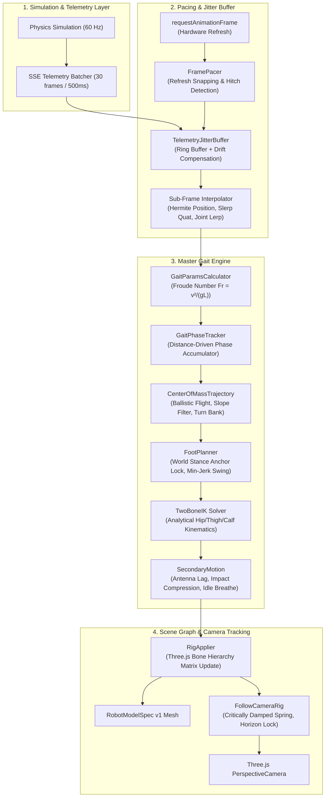

# Omni-Kinetic Droid: Fluid Animation Architecture & Locomotion Specification

## 1. System Overview & Architecture

The Omni-Kinetic animation rebuild replaces discrete, burst-driven telemetry playback with a continuous, physically grounded locomotion pipeline. The system guarantees sub-frame smoothness at the monitor's native refresh rate ($60\text{–}144\text{ Hz}$), zero foot skating, low-gravity ballistic arcs, and critically damped camera tracking.

---

## 2. Coordinate System & Single Frame Convention

All calculations strictly adhere to the project's **Single Frame Convention** (`/lib/frames`):

- **World Frame:** Right-handed, Y-up, meters.
  - $+X$: East
  - $+Y$: Up (gravity acts along $-Y$: $\mathbf{g} = [0, -1.62, 0]\text{ m/s}^2$)
  - $+Z$: South
- **Body Frame:**
  - $+X$: Forward
  - $+Y$: Up
  - $+Z$: Right (Left legs have negative local Z: $Z_{\text{FL}} = -0.15\text{m}$, $Z_{\text{RL}} = -0.15\text{m}$)
- **Yaw ($\theta$):**
  - $\theta = 0\text{ rad}$ points $+X$ East.
  - Forward direction in world coordinates: $\mathbf{f} = [\cos\theta, 0, -\sin\theta]$.
  - Heading extraction: $\theta = \text{atan2}(-v_z, v_x)$.

---

## 3. Mathematical Foundations

### 3.1 Dynamic Similarity & Froude Scaling (`lib/droid/gait/GaitParams.ts`)

In low-gravity environments ($g_{\text{moon}} = 1.62\text{ m/s}^2$ vs $g_{\text{earth}} = 9.81\text{ m/s}^2$), locomotion dynamics change fundamentally. Walking-to-bounding transitions, stride lengths, and step cadences are governed by the dimensionless **Froude Number**:

$$\text{Fr} = \frac{v^2}{g L}$$

where $v$ is forward velocity ($m/s$), $g$ is environmental gravity ($m/s^2$), and $L$ is nominal hip height ($0.385\text{ m}$).

1. **Gait Regimes:**
   - $\text{Fr} \le 0.5$: Walking gait (inverted pendulum, duty factor $0.50 \le \beta \le 0.65$).
   - $\text{Fr} > 0.5$: Bounding/trot with ballistic flight phase (duty factor $0.36 \le \beta < 0.50$).
2. **Natural Cadence Scaling:**
   $$\text{cadence}(g) = \text{cadence}_{\text{earth}} \cdot \sqrt{\frac{g}{g_{\text{earth}}}}$$
   Under lunar gravity, natural step frequency drops by approximately $59\%$ ($\sqrt{1.62 / 9.81} \approx 0.406$), giving the droid its authentic floating, low-gravity gait.

### 3.2 Minimum-Jerk Swing Profile (`lib/anim/math/minJerk.ts`)

To avoid jerk spikes during leg liftoff and touchdown, horizontal swing progress $u \in [0, 1]$ is parameterized by the unique 5th-order minimum-jerk polynomial satisfying zero velocity and acceleration boundary conditions ($C^2$ continuity):

$$u_{\text{smooth}}(u) = 10 u^3 - 15 u^4 + 6 u^5$$

Vertical ground clearance follows a parabolic arc centered at mid-swing ($u = 0.5$):

$$y_{\text{swing}}(u) = y_{\text{ground}} + 4 u (1 - u) h_{\text{clearance}}$$

### 3.3 Zero-Slip World Stance Anchoring (`lib/droid/gait/FootPlanner.ts`)

Foot skating occurs when a planted foot moves relative to the ground. In `FootPlanner`:
1. When a leg enters stance, its contact point is latched to an immutable world position:
   $$\mathbf{p}_{\text{worldAnchor}} = [x_{\text{touchdown}}, y_{\text{terrain}}, z_{\text{touchdown}}]$$
2. For all subsequent frames in stance, the foot's world position remains strictly identical to $\mathbf{p}_{\text{worldAnchor}}$.
3. Inverse kinematics converts $\mathbf{p}_{\text{worldAnchor}}$ back into the moving robot's body coordinate frame via `worldToBody(worldAnchor, bodyPose)`.
4. Kinematic reach limiting softly clamps the local position if the body exceeds reachable bounds, ensuring continuous numerical stability without moving the world anchor.

### 3.4 Analytical 2-Bone Inverse Kinematics (`lib/anim/ik/TwoBoneIK.ts`)

Each 3-DOF leg consists of a hip roll joint, thigh pitch joint, and calf pitch joint ($L_1 = 0.22\text{m}$, $L_2 = 0.22\text{m}$):
1. **Hip Roll ($\theta_{\text{hip}}$):** Rotates the leg plane toward the lateral foot offset:
   $$\theta_{\text{hip}} = \text{atan2}(z_{\text{foot}}, -y_{\text{foot}})$$
2. **Planar Distance ($D$):**
   $$D = \sqrt{x_{\text{foot}}^2 + (y_{\text{foot}}^2 + z_{\text{foot}}^2)}$$
   Soft extension limiting prevents singular pops near full extension:
   $$D_{\text{soft}} = D_{\text{max}} - d_0 \exp\left(-\frac{D - (D_{\text{max}} - d_0)}{d_0}\right)$$
3. **Calf Angle ($\theta_{\text{calf}}$):** By the Law of Cosines:
   $$\cos\theta_{\text{calf}} = \frac{D_{\text{soft}}^2 - L_1^2 - L_2^2}{2 L_1 L_2}, \quad \theta_{\text{calf}} = \pi - \arccos(\cos\theta_{\text{calf}})$$
4. **Thigh Angle ($\theta_{\text{thigh}}$):**
   $$\theta_{\text{thigh}} = \text{atan2}(x_{\text{foot}}, \sqrt{y_{\text{foot}}^2 + z_{\text{foot}}^2}) + \arctan\left(\frac{L_2 \sin\theta_{\text{calf}}}{L_1 + L_2 \cos\theta_{\text{calf}}}\right)$$

### 3.5 Critically Damped Follow Camera (`lib/camera/follow_camera.ts`)

The Chase camera follows the droid using exact analytical closed-form integration of a second-order critically damped spring:

$$x(t) = (c_1 + c_2 t) e^{-\omega t} + x_{\text{target}}$$

- Position and look-at targets are filtered independently with time constant $\tau = 0.16\text{s}$ ($\omega = 1 / \tau$).
- World Up is permanently locked to $(0, 1, 0)$ to prevent horizon tilting.
- Horizon pitch is bounded strictly between $20\%$ and $28\%$ from the viewport top.

---

## 4. Live Tuning & Gait Lab UI

For real-time inspection, A/B comparison, and tuning, the studio includes an in-engine debug interface:

- **Hotkey `G`:** Toggles the `GaitLab` overlay.
- **Command Palette (`Ctrl+K`):** Search `"Toggle Gait Lab (Fluid Animation)"` or `"Toggle Animation Mode (Fluid vs Baseline)"`.
- **Controls:**
  - **Fluid Animation Toggle:** Switch live between rebuilt fluid engine and legacy baseline.
  - **Gravity Slider:** Dynamically test locomotion under Moon ($1.62\text{ m/s}^2$), Mars ($3.72\text{ m/s}^2$), and Earth ($9.81\text{ m/s}^2$) gravities.
  - **Speed Multiplier:** Scale forward velocity from $0.2\times$ to $2.0\times$.
  - **Real-Time Telemetry HUD:** Displays live Froude number, cadence, duty factor, root jerk RMS, and stance slip.
