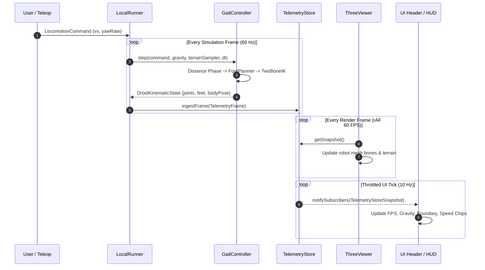

# Omni-Kinetic Studio: System Architecture Specification

## 1. Executive Architecture Summary
Omni-Kinetic is a browser-native Sim-to-Real Embodied AI Studio engineered for extreme rendering performance (60 FPS steady state), deterministic robotics simulation, and cloud physics integration.

```
+---------------------------------------------------------------------------------------+
|                                    NEXT.JS 14 APP                                     |
|                                                                                       |
|  +--------------------+  +----------------------+  +-------------------------------+  |
|  |     SHELL / UI     |  |   THREE.JS VIEWER    |  |       TELEOP OVERLAY          |  |
|  |  FpsBadge, Chips,  |  |  Regolith Terrain,   |  | WebGPU/WASM MediaPipe Worker, |  |
|  |  AnalogLogPane,    |  |  PBR Rock Materials, |  | OneEuroFilter, FABRIK IK,     |  |
|  |  Radar Minimap     |  |  Shadow Frustum 24m  |  | DAgger Demonstration Recorder |  |
|  +---------+----------+  +----------+-----------+  +---------------+---------------+  |
|            |                        |                              |                  |
+------------|------------------------|------------------------------|------------------+
             |                        |                              |
             v                        v                              v
+---------------------------------------------------------------------------------------+
|                                  SHARED CORE CONTRACTS                                |
|                                                                                       |
|  +---------------------+  +---------------------+  +-------------------------------+  |
|  |   /lib/telemetry    |  |      /lib/droid     |  |          /lib/frames          |  |
|  |  TelemetryStore,    |  |  GaitController,   |  |  Single Frame Convention:     |  |
|  |  LocalRunner,       |  |  TwoBoneIK, Phase,  |  |  World (Y-up), Body (+X fwd), |  |
|  |  TelemetryFrame v4  |  |  FootPlanner, CoM   |  |  Euler <-> Quat Transforms    |  |
|  +---------------------+  +---------------------+  +-------------------------------+  |
+---------------------------------------------------------------------------------------+
             |                                                       |
             v                                                       v
+---------------------------+                             +-----------------------------+
|    NEBIUS CLOUD ENGINE    |                             |       NVIDIA NEMOTRON       |
| Serverless Slurm / S3 Jobs|                             |   Nemotron-3-Ultra (550B)   |
| Streaming SSE Telemetry   |                             |   Physical Reasoning Engine |
+---------------------------+                             +-----------------------------+
```

---

## 2. Subsystem Ownership & Boundaries

### 2.1 Spatial Viewer (`/components/viewer/ThreeViewer.tsx`)
- **Graphics Pipeline**: WebGL 2.0 with ACES tone mapping, cascaded directional key light ($22^\circ$ elevation for long lunar shadows), and hemisphere ambient fill.
- **Shadow Frustum**: 24-meter box snapping to texels, eliminating edge crawl and shimmering.
- **Resource Management**: Strictly zero full scene destruction on state changes. Toggles (`showRadar`, `showOverlays`, `showGhostComparison`, `showColliderDebug`) bind to mutable refs rather than tearing down WebGL contexts or recompiling shaders.

### 2.2 Locomotion & Gait Engine (`/lib/droid/`)
- **Morphology**: 12-DOF quadruped with $0.22\text{ m}$ thigh and calf links.
- **Dynamics**: Froude dynamic similarity ($Fr = v^2 / (gL)$), distance-driven phase progression, and ground-anchored zero-slip stance locking ($< 10^{-6}\text{ m}$).
- **Kinematics**: Closed-form analytical 2-bone IK solver with zero heap allocation per frame.

### 2.3 Single Frame Convention (`/lib/frames/`)
A unified spatial coordinate contract enforced across simulation, viewer, teleoperation, and telemetry:
- **World Frame**: Right-handed, Y-up, meters. $+X$ is East, $+Y$ is Up, $+Z$ is South.
- **Body Frame**: $+X$ is Forward, $+Y$ is Up, $+Z$ is Right (left limbs have $-Z$).
- **Yaw Convention**: Yaw $\theta$ rotates $+X$ to $(\cos\theta, 0, -\sin\theta)$. Heading: $\text{atan2}(-v_z, v_x)$.

### 2.4 Telemetry & State Management (`/lib/telemetry/`)
- **Ring Buffer**: 600-frame circular telemetry buffer (`TelemetryStore`) supporting high-frequency ingestion (60 Hz) without triggering React component re-renders.
- **Throttled Subscription**: Debounced UI updates at 10 Hz (`scheduleNotify`), decoupling heavy simulation streaming from React rendering ticks.

### 2.5 Cloud & Nebius Integration (`/lib/nebius/`)
- Serverless job dispatch, telemetry chunk streaming over SSE, and token usage accounting (`UsageState`).
- Honest display reporting: zero pre-seeded token cost or request counts prior to user execution.

---

## 3. Data Flow & Execution Sequence


