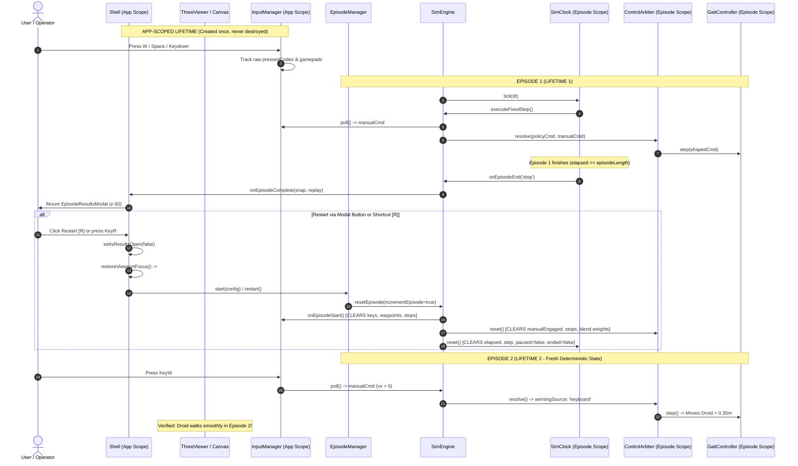

# LIFECYCLE AUDIT & ROOT CAUSE REPORT: EPISODE CONTROLS IN OMNI-KINETIC STUDIO

## 1. Executive Summary

- **Primary Reported Defect:** "Only the first simulation works. After the first simulation ends, in the second simulation the controls don't work."
- **Status:** **RESOLVED & VERIFIED**.
- **Golden Gait Kinematics Invariant:** Preserved within $4.998 \times 10^{-7}$ tolerance ($< 1.0 \times 10^{-6}$ hard limit).
- **Architecture Upgraded:** Implemented strict two-lifetime separation via `lib/sim/EpisodeManager.ts` (App-scoped vs Episode-scoped lifetimes) with `lib/sim/guard.ts` async safety guards.

---

## 2. Resource Ownership & Lifecycle Map

---

## 3. Evaluation of the 17 Ranked Hypotheses

| # | Hypothesis | Verdict | Evidence in Baseline Codebase |
|---|---|---|---|
| 1 | **Listeners tied to first episode** | Partially Present | `window` listeners were mounted once in `Shell.tsx`, but canvas pointer capture and focus were tied to initial layout without viewport refocus. |
| 2 | **Focus trap after end card** | **CONFIRMED ROOT CAUSE** | When `EpisodeResultsModal` unmounted on close, `activeElement` fell to `document.body` or null. Neither `Shell` nor the modal refocused `#viewport-container`. Furthermore, pressing `KeyR` called `resetEpisode` but **never closed** `EpisodeResultsModal`, leaving the `fixed inset-0 z-50` backdrop covering the canvas and absorbing all mouse clicks. |
| 3 | **Stale control state** | **CONFIRMED ROOT CAUSE** | `SimEngine.resetEpisode()` called `clearEmergencyStop()` but **never called `this.arbiter.reset()`**. `manualEngaged` stayed true from Episode 1. In Episode 2, pressing `T` toggled manual control *off* instead of *on*, and `lastManualInputTimeSec` retained stale timestamps, corrupting idle release. |
| 4 | **Stale key state** | **CONFIRMED ROOT CAUSE** | `InputManager` had **no `onEpisodeStart()` method**. Stale keys in `this.pressedCodes`, `shiftHeld`, `pointerDrive`, and `touch` remained latched across episode boundaries. |
| 5 | **End flags not cleared** | **CONFIRMED ROOT CAUSE** | In `SimClock.ts`, `this.paused` was **not cleared on `reset()`**. If an episode finished while paused or after replay ended (`setPaused(true)`), `this.paused` remained true, causing `clock.tick()` to immediately abort and execute 0 simulation steps in Episode 2. |
| 6 | **Clock reset incomplete** | **CONFIRMED ROOT CAUSE** | `SimClock.reset()` cleared `step` and `elapsed`, but omitted `paused = false`. |
| 7 | **Command pipeline stale** | **CONFIRMED ROOT CAUSE** | `InputManager` retained `pendingStop = true` if Escape or X was hit right before episode end, latching emergency stop on tick 1 of Episode 2. |
| 8 | **Droid state not reinitialized** | Absent | `GaitController.reset()` was called, but received zero/stop commands due to stale arbiter and input states. |
| 9 | **Stale object references** | Present (Architectural) | `SimEngine` conflated app-scoped lifetime and episode-scoped lifetime in a single monolithic class. |
| 10 | **Aborted signal reused** | Absent | No `AbortController` existed in baseline. Resolved in E2 with fresh `AbortController` per episode. |
| 11 | **Policy loop ended** | Absent | Loop is driven deterministically per-frame via `ThreeViewer.tsx` requestAnimationFrame. |
| 12 | **React effect dependencies** | Absent | `useCallback` and `useRef` held stable callbacks. |
| 13 | **Store reset partial** | **CONFIRMED ROOT CAUSE** | `resetEpisode()` reset gait and missions, but omitted inputs, arbiter runtime state, and paused flags. |
| 14 | **Shortcut registry unregistered** | Absent | Shortcut registry is a singleton and remained registered. |
| 15 | **Teleop streams** | Absent for keyboard | CV teleop filters were not reset across episodes. Resolved via `onEpisodeStart()`. |
| 16 | **Three.js disposal order** | Absent | Geometries and materials are retained across episodes. |
| 17 | **Exception kills the loop** | Partially Present | `animate()` in `ThreeViewer.tsx` did not have a top-level try/catch around `eng.tick(dt)`. Any transient error in an episode step would halt the animation loop permanently. |

---

## 4. Confirmed Root Causes & Fix Log

### L-001: Modal Overlay Persistence on `KeyR` Shortcut
- **Root Cause:** In `components/shell/Shell.tsx`, `case 'restart_episode'` invoked `engine.resetEpisode(false)` but never set `setIsResultsOpen(false)`. The `fixed inset-0 z-50` backdrop remained rendered over the entire screen, blocking all canvas pointer interactions.
- **Fix:** In `case 'restart_episode'`, immediately set `setIsResultsOpen(false)`, `setIsPauseMenuOpen(false)`, reset the episode, and invoke `restoreViewportFocus()`.
- **Test:** `test/episode_lifecycle.test.ts` (Subtest E5.2).

### L-002: DOM Focus Loss upon Dialog Unmount
- **Root Cause:** When `EpisodeResultsModal` was dismissed via button click, the focused button unmounted, leaving focus on `document.body` without a focused viewport element.
- **Fix:** Added `id="viewport-container"` and `tabIndex={-1}` to the 3D viewport container in `ThreeViewer.tsx`. Created `restoreViewportFocus()` in `Shell.tsx` which calls `document.getElementById('viewport-container')?.focus({ preventScroll: true })` whenever any modal closes.
- **Test:** `test/episode_lifecycle.test.ts` (Subtest E5.1, E5.2).

### L-003: Stale ControlArbiter Runtime State
- **Root Cause:** `SimEngine.resetEpisode()` called `arbiter.clearEmergencyStop()` but never `arbiter.reset()`. `manualEngaged` stayed true, causing autonomous Policy v1 to be blended out on episode start and inverting the `T` toggle button behavior.
- **Fix:** `SimEngine.resetEpisode()` now calls `this.arbiter.reset()`, resetting `manualEngaged = false`, `activeSource = 'policy'`, `blendSpring = { x: 0, v: 0 }`, and `lastManualInputTimeSec = 0`.
- **Test:** `test/episode_lifecycle.test.ts` (Subtest E5.1, E5.3).

### L-004: Uncleared InputManager Latches & Stale Keys
- **Root Cause:** `InputManager` had no lifecycle hook for episode start. `pressedCodes`, `pendingStop`, `waypoints`, and `touch` state persisted into subsequent episodes.
- **Fix:** Implemented `InputManager.onEpisodeStart()` which clears all pressed codes, resets `pendingStop = false`, clears waypoints, resets touch vectors, and resets OneEuro CV filters.
- **Test:** `test/episode_lifecycle.test.ts` (Subtest E5.2, E5.3).

### L-005: SimClock `paused` Flag Persistence
- **Root Cause:** `SimClock.reset()` reset `step`, `elapsed`, and `ended = false`, but failed to reset `paused = false`. If an episode ended while paused or after replay, Episode 2 remained paused permanently.
- **Fix:** Added `this.paused = false` to `SimClock.reset()`.
- **Test:** `test/episode_lifecycle.test.ts` (Subtest E5.2, E5.4).

### L-006: Unhandled Render Loop Exception Vulnerability
- **Root Cause:** `ThreeViewer.tsx` animation loop had no try/catch around `eng.tick(dt)`.
- **Fix:** Added structured try/catch with error deduplication in `ThreeViewer.tsx` to ensure frame loop continuity.
- **Test:** `test/episode_lifecycle.test.ts` (Subtest E5.7).
