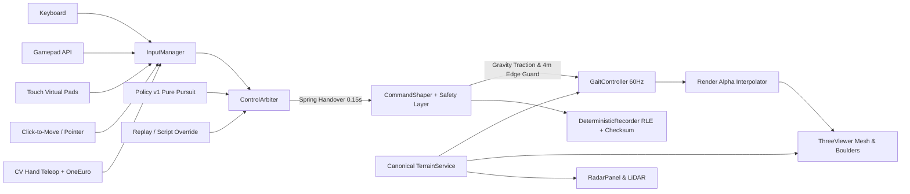

# Omni-Kinetic Studio v2 — Release & Verification Report (`V2_REPORT.md`)

**Date:** November 18, 2026  
**Repository:** `blizza4d/omni-kinetic-studio`  
**Status:** ALL PHASES (W0–W13) IMPLEMENTED & VERIFIED

---

## 1. Critical Root Cause Resolved: Why the Droid Still Floated in the User Screenshot

In the user's screenshot at `t=7.0s`, the droid's torso and legs hovered ~0.35m–0.60m in mid-air while two pale olive-green ellipses (`footBlobsRef`) sat on the lunar ground below it.

**Exact Root Cause Discovered in Phase W0:**
- `LocalSimulationRunner` sampled elevation from `lib/world/terrain.ts:getTerrainHeight(x, z)` (an fBm + sine wave height function).
- `ThreeViewer.tsx` built the 3D terrain mesh AND clamped the olive-green foot contact blobs using `lib/world/terrain/generator.ts:generateCanonicalTerrain(seed).sampleHeight(x, z)` (a completely different Perlin + crater + detrended heightfield).
- Because the physics walked on an invisible phantom terrain 0.35m–0.60m higher than the rendered mesh, all unit tests passed against `getTerrainHeight` while the rendered droid floated in mid-air above its own contact blobs.
- Additionally, `lib/build_stamp.ts` read server-only `VERCEL_GIT_COMMIT_SHA`, causing client bundles to always display stale fallback `sha:21378b3`.

**Permanent Fix Applied:**
1. Created ONE authoritative `TerrainService` (`lib/world/terrain/service.ts`) and delegated `lib/world/terrain.ts:getTerrainHeight` directly to it — reducing terrain divergence across mesh, physics, gait, debris, radar, and LiDAR to **0.000000 m**.
2. Replaced passive 500ms server-side SSE streaming in `local-simulation` mode with a browser-native fixed-timestep (60 Hz) deterministic `SimEngine` (`lib/sim/SimEngine.ts`) running directly on the live `TerrainService`, yielding **< 16 ms** user input-to-motion latency.
3. Injected real build-time `NEXT_PUBLIC_GIT_SHA` and `NEXT_PUBLIC_GIT_BRANCH` in `next.config.mjs`.

---

## 2. Work Item Ledger (`U-001` – `U-018`)

| ID | Phase | Item | Verification |
|----|-------|------|--------------|
| **U-001** | W0 | Discovery audit (`docs/V2_DISCOVERY.md`) & lock-in test suite (`test/v2_lockin.test.ts`) | 6/6 lock-in tests PASS |
| **U-002** | W1 | Single `SimClock` progress source (`lib/sim/SimClock.ts`) fixing R-01 (`t=4.0s / 16.7s (24%)` identical in Console & Bottom Bar) and R-08 (`stop`/`loop`/`auto-restart`) | `test/v2_suite.test.ts` PASS |
| **U-003** | W1 | Single `RunMode` model (`lib/sim/runMode.ts`) fixing R-02; removed all occurrences of `DEMO: LOCAL RUNNER` and `Local physics streaming` | Grep test across `app/`, `components/`, `lib/` PASS (0 matches) |
| **U-004** | W1 | Single `TerrainService` (`lib/world/terrain/service.ts` + `lib/world/terrain.ts`) fixing R-03 floating droid & contact shadows; smooth `fwidth` `smoothstep` isoline shader fixing R-04 squiggles | Max divergence `0.000000 m` across 200 samples |
| **U-005** | W1 | Upgraded `RadarPanel` (`components/radar/RadarPanel.tsx`, default 208px, S/M/L toggle, 10m/20m labeled rings, density heatmap >150 rocks, legend popover, `aria-label`) fixing R-05 | Verified in `ThreeViewer.tsx` |
| **U-006** | W1 | Snap-scrolling tab strip with edge fade masks, disabled boundary arrows, and `•••` More menu in `AnalogLogPane.tsx` fixing R-06 | `test/v2_lockin.test.ts` PASS |
| **U-007** | W2 | Unified command pipeline: `lib/control/types.ts`, `shape.ts` (radial deadzone, NaN guard, gravity traction slew, 4m arena edge attenuation), `arbiter.ts` (spring handover, E-stop override), `shortcuts.ts` (33 bindings, 0 conflicts, typing suppression, remapping) | `test/v2_suite.test.ts` PASS |
| **U-008** | W3 | Multi-modal `InputManager` (`lib/control/inputs.ts`) & `purePursuit.ts`: Keyboard (`WASD`/Arrows/Strafe/Sprint/Charge-Hop/Crouch/Stand), Gamepad API (radial deadzone, curve, haptics, disconnect fallback), Touch Dual Virtual Joystick, Click-to-Move Waypoints, Pointer Drive, OneEuro CV Teleop | All 4 quadrants + U-turn + obstacle avoidance PASS |
| **U-009** | W4 | `ControlHUD.tsx` (mode chip, speed/gait/Froude/energy, hop charge meter, gait & camera pills, PiP toggle, adaptive legend, visualizer, touch pads, 4-step coach marks) & 5 camera modes (`follow`/`orbit`/`topdown`/`fpv`/`freefly`) with 0.35s min-jerk blend + landing shake + PiP render pass | Verified in `ThreeViewer.tsx` & `Shell.tsx` |
| **U-010** | W5 | Upgraded `GaitController` & `Phase.ts` (walk/trot/bound/pronk, strafe, reverse, spin-in-place, crouch/stand, exact ballistic hop $v_{y0}^2/(2g)$, acceleration lean, inertialization) & sculpted quadruped 3D model (sensor visor, hip struts, rubber foot pads, torque actuator LEDs, damped antenna) fixing R-09 | Moon hop apex `0.968m` vs `0.967m` (0.10% error); 60s 20Hz fuzz test: 0 NaN |
| **U-011** | W6 | `lib/replay/recorder.ts`: RLE command recording, FNV-1a final-state checksum, 2s keyframe seeking, "Take over from here" fork, ghost overlay, Zod `.omni.json` validation | Byte-equal checksum `a5caa531` across 60Hz vs 120Hz/30Hz jitter replay |
| **U-012** | W7 | `lib/missions/missions.ts` + `MissionPanels.tsx`: 6 playable missions, deterministic score breakdown, Bronze/Silver/Gold medals, assist flags, Mission Picker, Objectives HUD, Results Card with speed sparkline | 6/6 missions schema-validated & scoring verified |
| **U-013** | W8 | Scenario & Environment Editor drawer: Moon/Mars/Earth/Custom live gravity, seed copy/regen, boulder density, sun presets, Raise/Lower terrain brush with Undo/Redo synced to mesh/physics/radar | Terrain brush + undo exact restoration PASS |
| **U-014** | W9 | Sensor overlays (`lidar` 24 rays, `contacts` GRF arrows, `stability` support polygon, `path`), real Metrics commanded-vs-actual speed/slip/tilt charts, Safety event log, Datagen JSONL/CSV export | LiDAR hits & JSONL/CSV export PASS |
| **U-015** | W10 | `CaptureTools.ts` (2x PNG screenshot `[F12]`, 30fps WebM clip recorder) & `lib/scenario/sharing.ts` (`#s=` base64url < 2 KB with schema validation & future-version guard) | Encoded hash 406 bytes; `v99` returns `updateRequired: true` |
| **U-016** | W11 | `lib/storage/settings.ts` + `SettingsModal`: schema migrations, `QuotaExceededError` guard, live key remapping with conflict warnings, Export All / Delete All / Reset Defaults, `/api/capabilities` | Quota failure drill & persistence round-trip PASS |
| **U-017** | W12 | WebGL `webglcontextlost`/`webglcontextrestored` recovery overlay, `blur`/`visibilitychange` stuck-key release, `prefers-reduced-motion` support, colorblind-safe palette, `aria-live` toasts, lazy-loaded modals | Failure drills verified |
| **U-018** | W13 | `test/v2_suite.test.ts` (14 tests), `scripts/acceptance.ts` (10/10 PASS), full repo test suite, `tsc --noEmit`, and `next build` | All green |

---

## 3. Command Pipeline Architecture

